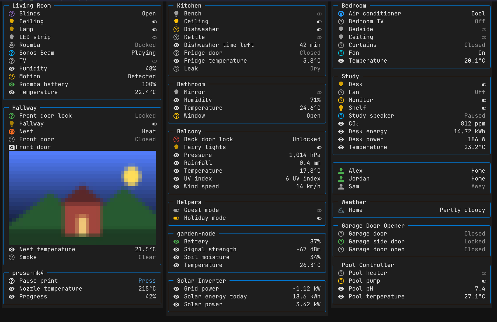

# hatui

A Terminal User Interface (TUI) Home Assistant dashboard using the Textual library.



## Features

  * [x] Lightweight enough to run on a Raspberry Pi 1b (sort of, it's still slow)
  * [x] Displays the same entities you see on the default Lovelace dashboard
  * [x] Entities grouped the same
  * [x] Entities display their friendly name
  * [x] Most entity states are humanised and displayed with their units
  * [x] Entities states update in realtime
  * [x] Entity icons are displayed (assumes you have Nerdfonts installed)
  * [x] Lights are coloured, same as the UI
  * [x] Animation on refresh
  * [x] Full implementation of reactive icons
  * [x] Full implementation of state translations
  * [x] Translation of sensor group names
  * [x] Ordering of groups identical to Lovelace
  * [x] Most things are interactive
  * [x] Refresh on adding/removing entities
  * [x] Progress bar on first load
  * [x] Popup modals with graphs
  * [x] Image (e.g. webcam) entities converted to ASCII

## Usage

```shell
uv tool install git+https://github.com/aarongorka/hatui.git # or `pipx install [...]`
export HATUI_WS_URL=ws://<your HA hostname>:8123/api/websocket
export HATUI_TOKEN=<token obtained from your profile on the left sidebar -> security tab -> long-lived access tokens>
hatui
```

Or for debugging:

```shell
textual console --exclude 'EVENT'
```

```shell
textual run --dev hatui.main:get_dashboard
```
